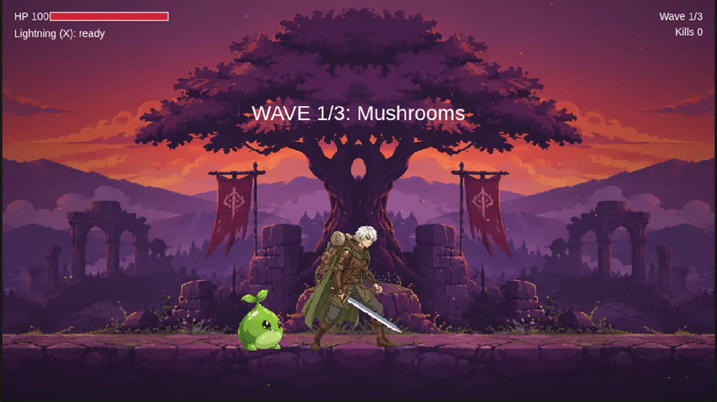

<div align="center">

# ⚔️ DUSKBOUND ⚔️

### *The sun is setting. The monsters are rising. Hold the line.*




</div>

---

## 🌅 About

**DUSKBOUND** is a 2D pixel-art survival brawler that runs right in your browser. You play a lone swordsman, with a loyal slime companion at your side, standing in the ruins of a battlefield as the sky burns orange. Three waves of monsters crawl out of the dusk, and the last one is a giant stone **Golem**. Survive them all.

I designed and built it for the **Haven Cairo game jam**, the Hack Club game jam for teenagers, held on **November 15, 2026** at GEMS British International School Madinaty.

## ✨ Features

- 🗡️ **Fast sword combat** with knockback, hit sparks, screen shake and floating damage numbers
- ⚡ **Lightning skill** that strikes up to 4 nearby enemies at once (3-second cooldown)
- 🟢 **A slime pet** that follows you and joins the fight
- 🌊 **3 escalating waves:** Mushrooms → Goblins → **The Golem** boss
- 💚 **+25 HP** every time you clear a wave
- 🌇 **Cinematic sunset battlefield** with parallax scrolling, drifting embers and a vignette
- 🔊 **Full sound design:** background music, sword swings, a unique attack sound for each monster, a boss entrance roar, and game-over and victory jingles
- 🏆 **Score system** that rewards kills, remaining health and speed

## 🎮 Controls

| Key | Action |
|---|---|
| `←` `→` or `A` `D` | Move |
| `↑` or `W` | Jump |
| `Space` | Sword attack |
| `X` | Lightning skill |
| `M` | Toggle music |
| `R` | Restart |

<details>
<summary>🛠️ Extra debug and tweak keys</summary>

| Key | Action |
|---|---|
| `G` | Show the ground guide line |
| `[` / `]` | Move the ground line up / down (saved in your browser) |
| `C` | Toggle cinematic letterbox bars |
| `B` | Switch background mode (if layered backgrounds are present) |
| `H` | Toggle the asset-loading report |

</details>

## 👾 The Enemies

| Enemy | HP | Threat |
|---|---|---|
| 🍄 **Mushroom** | 30 | Slow and weak, but they come in a group |
| 👺 **Goblin** | 50 | Quick and aggressive |
| 🗿 **Golem** | 180 | A huge boss with a heavy, screen-shaking attack and long reach |

## 🚀 Run it locally

DUSKBOUND needs no build step and no dependencies. It only needs to be served over HTTP, because it auto-detects the sprite folders at startup.

```bash
# clone the repo
git clone https://github.com/khloozaa/DUSK-BOUND.git
cd DUSK-BOUND

# start any static server, for example:
python -m http.server 8000
```

Then open **http://localhost:8000** in your browser and press any key to start the music.

> 💡 Browsers block audio until you interact with the page, so the music begins on your first key press or click.

## 📁 Project structure

```
DUSK-BOUND/
├── assets/            # character packs, effects, sprites
├── backgraund/        # sunset battlefield background
├── screenshots/       # gameplay GIF used in this README
├── sound_effects/     # music and all sound effects
├── index.html         # page + canvas
├── game.js            # the entire game (loop, combat, waves, audio)
└── style.css
```

## 🔊 Sound effects

| File | Used for |
|---|---|
| `backgroundmusic.mp3` | Looping background music |
| `swordsound.mp3` | Sword swings (and the lightning skill, slowed down) |
| `mushrom attack.mp3` | Mushroom attacks |
| `goblin_attack.mp3` | Goblin attacks |
| `large-monster-attack.mp3` | Golem attacks |
| `large_monester_apper.mp3` | The Golem's entrance |
| `gameover.mp3` | When you fall |
| `vectory.mp3` | When you win |

## 🧠 Built with

- **Vanilla JavaScript**, with no frameworks and no libraries
- **HTML5 Canvas** for all rendering
- Sprite-sheet auto-detection that finds animation frames and sizes on its own
- The **Web Audio / HTMLAudio API** for the sound system

## 🏁 Made at Haven Cairo

This game was made in a single day at **[Hack Club Haven](https://haven.hackclub.com/cairo)**, a game jam for teenagers aged 13 to 18, held in 200+ cities worldwide. Haven is run by [Hack Club](https://hackclub.com), a nonprofit and network of 100k+ technical high schoolers. Made with ♥ by a teenager, for teenagers.

## 🙏 Credits

- **Game design and code:** [@khloozaa](https://github.com/khloozaa)
- **Art, music and sound effects:** *add the creators and links for your sprite packs, background, music and sound files here*

---

<div align="center">

**If you survive the Golem, you're a legend. ⚔️🌇**

</div>
